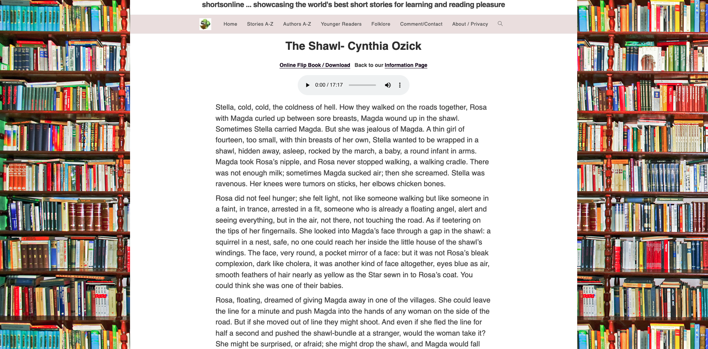
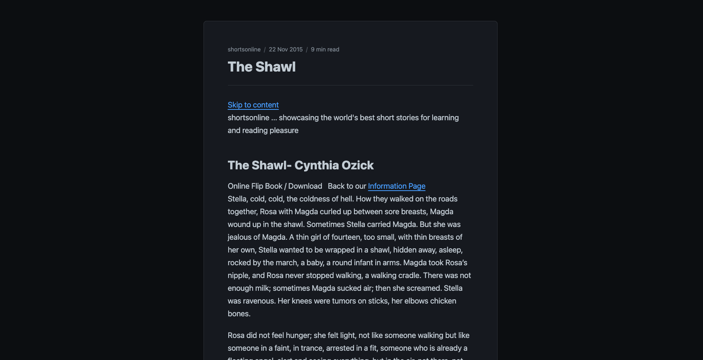

# Like Ebook

Like Ebook is a Chrome extension that gives web articles and short stories a clean, book-like layout. Adjust the text size and choose a light, dark, or sepia theme.

## Before and after

**Before · The original website**

**After · The same story in Like Ebook**

## Download and install in Chrome

1. [Download Like Ebook (ZIP)](https://github.com/ampo0809/likeEbook/archive/refs/heads/master.zip).
2. Unzip the download. On a Mac, double-click the ZIP file. On Windows, right-click it and choose **Extract All**.
3. On your computer, type `chrome://extensions` into Chrome’s address bar and press Enter.
4. Turn on **Developer mode** in the top-right corner.
5. Click **Load unpacked** and select the **likeEbook-master** folder.

Open an article, click the puzzle piece icon next to Chrome’s address bar, then click **Like Ebook** to open the reading view.

## Download as EPUB

With the reading view open, click **EPUB** in the toolbar. Open the downloaded file in your ebook app or transfer it to an EPUB-compatible e-reader to read offline.
